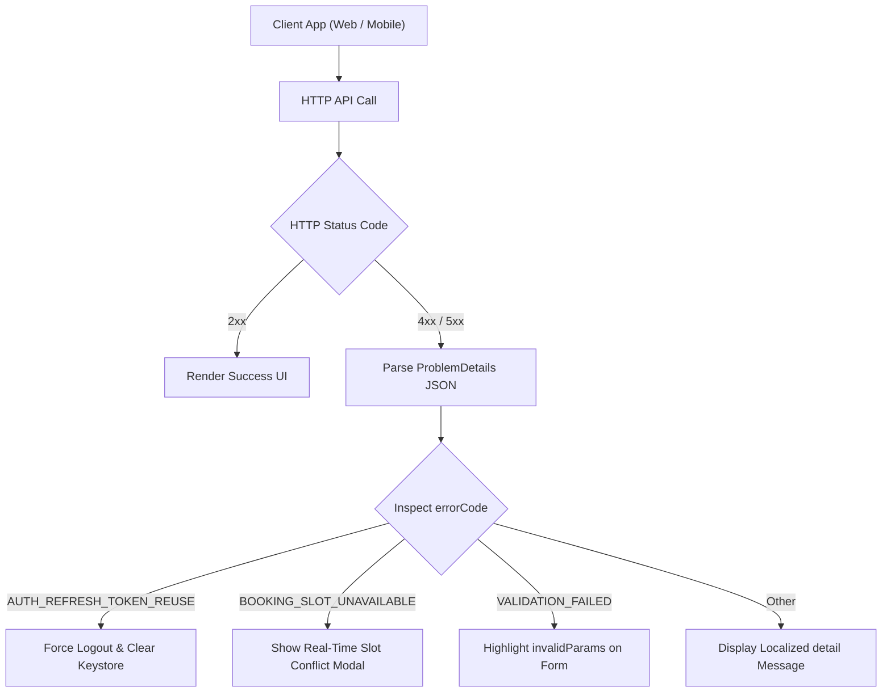

# Malabak Machine Error Code Catalog

## 1. Overview & Error Handling Contract

All Malabak API errors return an RFC 9457 `application/problem+json` response containing a stable, uppercase string `errorCode`. 

Front-end applications (Web & Mobile) MUST inspect `errorCode` rather than parsing error message strings to make programmatic decisions (e.g. redirecting to login, prompting for OTP re-entry, or displaying field highlights).

---

## 2. Global & System Error Codes

| Error Code | HTTP Status | English Description (en-US) | Arabic Description (ar-EG) | Client Action |
|---|---|---|---|---|
| `VALIDATION_FAILED` | `400` | One or more validation errors occurred. | حدث خطأ في التحقق من صحة البيانات المدخلة. | Inspect `invalidParams` array and display errors next to respective input fields. |
| `IDEMPOTENCY_KEY_REQUIRED` | `400` | The Idempotency-Key header is required for this request. | مفتاح العمليات المتكررة (Idempotency-Key) مطلوب لهذا الطلب. | Generate a UUID v4 and supply it in the `Idempotency-Key` header. |
| `IDEMPOTENCY_CONFLICT` | `409` | A concurrent request with this Idempotency-Key is currently being processed. | يوجد طلب آخر قيد التنفيذ بنفس المفتاح، يرجى المحاولة بعد لحظات. | Wait 1-2 seconds and retry request using the same key. |
| `IDEMPOTENCY_PAYLOAD_MISMATCH` | `422` | Idempotency-Key already used with a different request payload. | تم استخدام هذا المفتاح مسبقاً ببيانات طلب مختلفة. | Do not reuse keys across distinct user actions; generate a new key. |
| `RATE_LIMIT_EXCEEDED` | `429` | Too many requests. Please try again later. | تم تجاوز الحد المسموح به من الطلبات، يرجى الانتظار والمحاولة لاحقاً. | Inspect `Retry-After` header and delay next request. |
| `UNAUTHORIZED` | `401` | Authentication is required to access this resource. | غير مصرح، يرجى تسجيل الدخول أولاً. | Attempt access token refresh via refresh token; if failed, redirect to login. |
| `FORBIDDEN` | `403` | You do not have permission to access this resource. | ليس لديك الصلاحية الكافية للوصول إلى هذا المورد. | Display permission denial banner; do not retry without elevated role. |
| `RESOURCE_NOT_FOUND` | `404` | The requested resource was not found. | المورد المطلوب غير موجود. | Show empty state or redirect to parent collection view. |
| `CONFLICT` | `409` | A conflict occurred with the current state of the resource. | تعارض في حالة المورد أو العملية المطلوبة. | Fetch latest resource state via `GET` and prompt user to resolve difference. |
| `INTERNAL_SERVER_ERROR` | `500` | An unexpected error occurred. Please try again later. | حدث خطأ غير متوقع في الخادم، يرجى المحاولة لاحقاً. | Display friendly error modal with `traceId` for customer support assistance. |

---

## 3. Identity, Authentication & Security Error Codes

| Error Code | HTTP Status | English Description (en-US) | Arabic Description (ar-EG) | Client Action |
|---|---|---|---|---|
| `AUTH_INVALID_CREDENTIALS` | `401` | Invalid phone number or password. | بيانات الدخول غير صحيحة. | Prompt user to check phone number and re-enter password. |
| `AUTH_USER_NOT_FOUND` | `404` | User account was not found. | المستخدم غير موجود. | Prompt user to create a new account. |
| `AUTH_PHONE_ALREADY_EXISTS` | `409` | Phone number is already registered. | رقم الهاتف مسجل بالفعل مسبقاً. | Direct user to login screen or password reset flow. |
| `AUTH_OTP_EXPIRED` | `400` | Verification code has expired. | انتهت صلاحية رمز التحقق. | Enable "Resend Code" button and prompt user to request a new OTP. |
| `AUTH_OTP_MAX_ATTEMPTS` | `429` | Maximum verification attempts exceeded. | تم استنفاد الحد الأقصى لمحاولات إدخال الرمز. | Lock OTP entry for 15 minutes; advise user to wait. |
| `AUTH_TOKEN_REVOKED` | `401` | Refresh token has been revoked. | تم إلغاء صلاحية رمز الدخول. | Clear cached tokens in secure storage and route to login. |
| `AUTH_REFRESH_TOKEN_REUSE` | `401` | Compromised refresh token reuse detected. | تم اكتشاف محاولة استخدام رمز أمان ملغي. | Clear all local credentials immediately; alert user of possible compromise. |

---

## 4. Booking & Pitch Reservation Error Codes

| Error Code | HTTP Status | English Description (en-US) | Arabic Description (ar-EG) | Client Action |
|---|---|---|---|---|
| `BOOKING_SLOT_UNAVAILABLE` | `409` | Selected pitch slot is already booked. | الفترة الزمنية المختارة محجوزة بالفعل من قبل لاعب آخر. | Refresh pitch calendar; prompt player to choose an alternative slot. |
| `BOOKING_SLOT_LOCKED` | `423` | Slot is temporarily held by another customer. | الفترة محجوزة مؤقتاً للاعب آخر قيد الدفع، يرجى الانتظار 10 دقائق. | Display countdown timer; slot will release if deposit is not confirmed. |
| `BOOKING_CANCEL_WINDOW_EXPIRED`| `400` | Free cancellation window has passed. | لا يمكن إلغاء الحجز، لقد انتهت المهلة المجانية للإلغاء. | Inform user that cancellation now incurs deposit forfeiture per policy. |
| `BOOKING_DEPOSIT_REQUIRED` | `400` | Upfront deposit is required to hold this slot. | الحجز يتطلب دفع العربون خلال المهلة المحددة لتأكيد الموعد. | Open payment proof upload screen (InstaPay / Vodafone Cash). |
| `BOOKING_PROOF_EXPIRED` | `400` | Payment proof submission window expired. | انتهت مهلة رفع إيصال التحويل، وتم تحرير الملعب. | Re-open booking slot selection. |
| `BOOKING_INVALID_STATE_TRANSITION` | `422` | Cannot perform requested transition on current booking state. | لا يمكن تغيير حالة الحجز الحالية إلى الحالة المطلوبة. | Refresh booking details screen to synchronize latest state. |

---

## 5. Domain Value Object Validation Codes

| Error Code | HTTP Status | English Description (en-US) | Arabic Description (ar-EG) | Client Action |
|---|---|---|---|---|
| `PhoneNumber.Empty` | `400` | Phone number is required. | رقم الهاتف مطلوب ولا يمكن أن يكون فارغاً. | Prompt user to input phone number. |
| `PhoneNumber.InvalidEgyptianNumber` | `400` | Phone number must be a valid Egyptian mobile number (010, 011, 012, 015). | رقم الهاتف غير صالح، يجب أن يكون رقماً مصرياً يبدأ بـ 010 أو 011 أو 012 أو 015. | Validate against regex `^(\+?20\|0)?1[0125]\d{8}$`. |
| `Money.NegativeAmount` | `400` | Monetary amount cannot be negative. | المبلغ المالي لا يمكن أن يكون سالباً. | Ensure input is non-negative. |
| `Money.InvalidCurrency` | `400` | Unsupported currency. Only EGP is accepted. | العملة غير مدعومة، العملة المعتمدة هي الجنيه المصري (EGP). | Pass `"EGP"` as default currency. |
| `TimeSlotRange.InvalidRange` | `400` | Slot start time must be before end time. | وقت بداية الحجز يجب أن يكون قبل وقت النهاية. | Adjust end time slider/picker. |
| `TimeSlotRange.ExceedsMaxDuration` | `400` | Booking duration exceeds the 6-hour limit. | مدة الحجز تتجاوز الحد الأقصى المسموح به (6 ساعات). | Split into multiple booking reservations if needed. |
