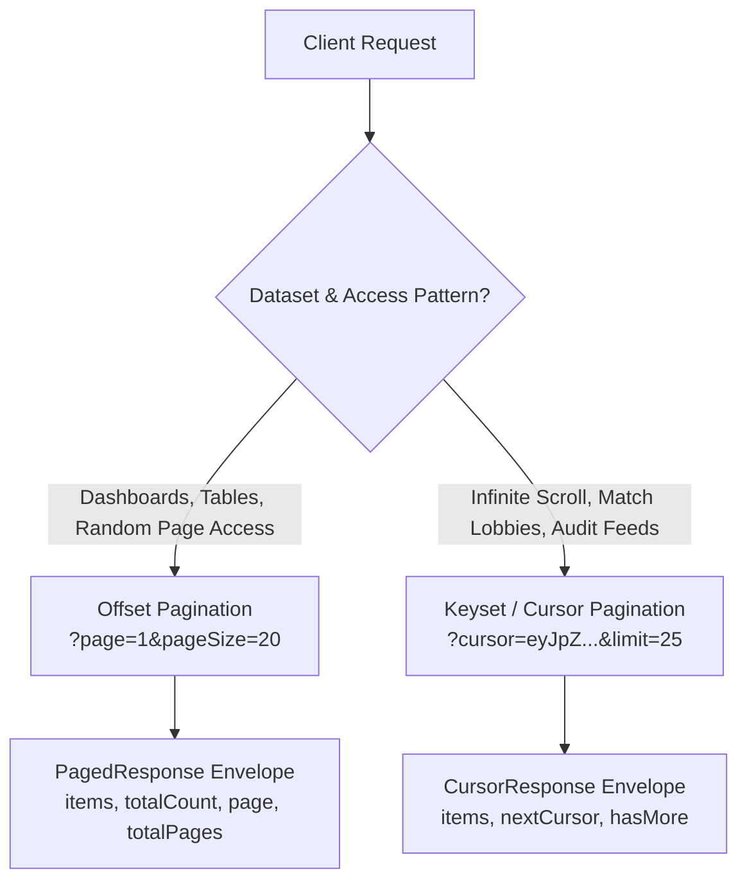

# API Pagination, Filtering & Sorting Specification

## 1. Pagination Standards

The Malabak API provides two standardized pagination strategies depending on the dataset characteristics:



---

## 2. Offset-Based Pagination

Used across administrative lists, venue schedules, and player search filters.

### Query Parameters
| Parameter | Type | Default | Constraint | Description |
|---|---|---|---|---|
| `page` | integer | `1` | `>= 1` | 1-based page index |
| `pageSize` | integer | `20` | `1 <= pageSize <= 100` | Number of items per page |

### Standard Response Envelope
```json
{
  "items": [
    {
      "id": "0192d4f8-1111-7000-8000-000000000001",
      "name": "ملعب النادي الأهلي",
      "governorate": "القاهرة"
    }
  ],
  "page": 1,
  "pageSize": 20,
  "totalCount": 85,
  "totalPages": 5,
  "hasPreviousPage": false,
  "hasNextPage": true
}
```

---

## 3. Cursor-Based Pagination (Keyset)

Used for real-time match lobbies, infinite scroll feeds, and high-frequency audit logs to avoid drift from concurrent inserts.

### Query Parameters
| Parameter | Type | Default | Description |
|---|---|---|---|
| `cursor` | string | `null` | Base64-encoded opaque cursor identifying current pointer |
| `limit` | integer | `25` | Max records to return (`1 <= limit <= 50`) |

### Standard Response Envelope
```json
{
  "items": [
    {
      "id": "0192d4f8-2222-7000-8000-000000000042",
      "createdAt": "2026-10-29T14:30:00Z"
    }
  ],
  "nextCursor": "eyJpZCI6IjAxOTJkNGY4LTIyMjItNzAwMC04MDAwLTAwMDAwMDAwMDA0MiIsInQiOjE3OTMyNzM4MDAwMDB9",
  "hasMore": true
}
```

---

## 4. Filtering Conventions

Filters are passed as query parameters using exact matching, ranges, or multi-value lists:

### 4.1 Exact Match & Multi-Select
- Single value: `?status=Confirmed`
- Multiple values (comma-separated): `?status=Confirmed,PendingDeposit`

### 4.2 Date & Numeric Ranges
Range filters use explicit `from` / `to` or `min` / `max` parameter prefixes:
- Dates (ISO 8601 UTC): `?fromDate=2026-11-01T00:00:00Z&toDate=2026-11-02T23:59:59Z`
- Prices: `?minPrice=200&maxPrice=500`

### 4.3 Text Search
Full-text or prefix search uses the `q` parameter:
- `?q=الاهلي`

---

## 5. Sorting Conventions

Sorting is requested via the `sort` query parameter:
- **Ascending:** `?sort=pricePerHour`
- **Descending:** Prefix field name with hyphen `-`, e.g. `?sort=-createdAt`
- **Multiple Fields:** Comma-separated in priority order: `?sort=-createdAt,pricePerHour`
