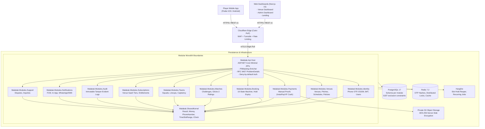

# Malabak Architecture Overview

Malabak is implemented as a **Modular Monolith** in .NET 10, adhering to Clean Architecture principles within each bounded context.

---

## 1. High-Level System Architecture

---

## 2. Module Rules & Boundary Enforcement
1. **Zero Direct Module Coupling:** A module must never reference another module's assembly directly. This rule is enforced at compile-time and continuously verified by `Malabak.ArchitectureTests`.
2. **Integration via Contracts & Domain Events:** Cross-module communication occurs strictly via `SharedKernel` primitives, Outbox integration events, or mediator handlers.
3. **Dedicated PostgreSQL Schemas:** Each module owns its dedicated schema (`identity.*`, `venues.*`, `booking.*`, `payments.*`, `teams.*`, `matches.*`, `subscriptions.*`, `audit.*`, `notifications.*`, `support.*`). Cross-schema SQL joins are strictly forbidden.
4. **Time & Clock Abstraction:** All domain models and handlers depend on `IClock` rather than `DateTime.UtcNow` or `DateTime.Now`, ensuring full testability and accurate Egyptian Time Zone (`Africa/Cairo`) conversions.
