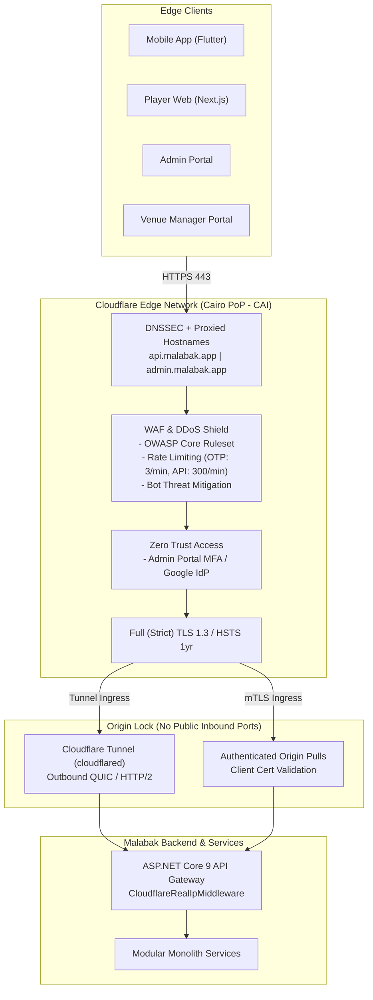

# Cloudflare Baseline Architecture: DNS, TLS, Origin Lock, WAF & Zero Trust Access

## 1. Executive Summary

This architecture guide details the implementation of **[TASK-114]** per the security requirements established in **[ADR-0004](file:///home/osama/Desktop/mal3abk-backend/docs/adr/0004-hosting-and-data-residency.md)** and **[SECURITY.md](file:///home/osama/Desktop/mal3abk-backend/docs/SECURITY.md)**.

All public traffic to the Malabak platform ingresses through Cloudflare's Egyptian Edge Point of Presence (`CAI` - Cairo Internet Exchange). The origin servers remain completely dark to the public internet using **Cloudflare Tunnel (`cloudflared`)** and **Authenticated Origin Pulls (mTLS)**, preventing IP leakage, DDoS attacks, and bypasses of edge security controls.

---

## 2. DNS Proxied Hostnames and DNSSEC

### 2.1 Zone Topography
All public hostnames are managed in the `malabak.app` Cloudflare zone and **must always have the orange cloud (proxied = true) enabled**:

| Hostname | Type | Target / Mode | Proxy Status | Description |
|---|---|---|---|---|
| `api.malabak.app` | CNAME / A | `<tunnel-id>.cfargotunnel.com` | **Proxied (Orange Cloud)** | Public API gateway for Mobile & Web clients |
| `admin.malabak.app` | CNAME / A | `<tunnel-id>.cfargotunnel.com` | **Proxied (Orange Cloud)** | Super-admin management portal (Zero Trust) |
| `venue.malabak.app` | CNAME / A | `<tunnel-id>.cfargotunnel.com` | **Proxied (Orange Cloud)** | Venue Owner & Staff management portal |
| `malabak.app` | CNAME / A | `<tunnel-id>.cfargotunnel.com` | **Proxied (Orange Cloud)** | Apex landing and player portal |
| `www.malabak.app` | CNAME | `malabak.app` | **Proxied (Orange Cloud)** | Canonical redirect to apex |
| `staging-api.malabak.app` | CNAME / A | Staging Tunnel | **Proxied (Orange Cloud)** | Pre-production testing environment |

### 2.2 DNSSEC Protection
- DNSSEC is actively enabled on the zone via `cloudflare_zone_dnssec.malabak_dnssec`.
- Cryptographic DS records are generated by Cloudflare and registered at the top-level registrar to eliminate DNS cache poisoning and man-in-the-middle spoofing.
- Registrar domain lock is enabled to prevent unauthorized domain hijacking.

### 2.3 Email & IP Leakage Prevention
To ensure the origin server's true IP address is never revealed through MX or TXT lookups:
- MX records point exclusively to third-party mail providers (Google Workspace).
- SPF records use `v=spf1 include:_spf.google.com ~all` without including origin IPs.
- DMARC enforcement policy is configured to `p=reject`.

---

## 3. SSL/TLS Full (Strict), HSTS and Origin CA

### 3.1 Encryption Mode: Full (Strict)
The platform enforces **Full (strict)** SSL/TLS encryption. Cloudflare validates that the origin server presents a valid SSL certificate signed by the Cloudflare Origin CA. Self-signed certificates without origin verification are rejected.

### 3.2 TLS Parameters
- **Minimum TLS Version:** Enforced at **TLS 1.2**. Legacy protocols (TLS 1.0, TLS 1.1, SSLv3) are rejected at the edge.
- **TLS 1.3:** Enabled by default.
- **0-RTT (Zero Round Trip Time):** Disabled (`zero_rtt = "off"`) across all zones to eliminate replay attack vectors on sensitive booking and transaction requests.
- **Automatic HTTPS Rewrites:** Enabled.
- **Always Use HTTPS:** Enabled (HTTP port 80 requests are automatically redirected to 443 with 301/308).

### 3.3 HSTS (HTTP Strict Transport Security)
Enforced with high strictness:
- `max-age = 31536000` (1 year)
- `includeSubDomains = true`
- `preload = true`
- `nosniff = true`

---

## 4. Origin Lock: Cloudflare Tunnel & Authenticated Origin Pulls

### 4.1 Primary Defense: Cloudflare Tunnel (`cloudflared`)
The origin infrastructure operates under a **Zero Open Port** model:
1. No inbound firewall rules (ports 80/443/5000) are opened to the public internet on the hosting server.
2. The lightweight daemon `cloudflared` runs on the host and initiates persistent outbound connections via QUIC (HTTP/3) / HTTP/2 to Cloudflare edge data centers.
3. Traffic is routed internally to local service ports (`127.0.0.1:5000` for ASP.NET Core API).
4. Direct-to-IP scanning attacks (e.g. Shodan, Censys) cannot find or probe the origin.

### 4.2 Secondary Defense: Authenticated Origin Pulls (mTLS) + Firewall Allowlist
For standalone reverse proxies (e.g. Nginx on VPS instances):
1. **Authenticated Origin Pulls (AOP):** Nginx validates the Cloudflare client CA certificate (`cloudflare-origin-pull-ca.pem`) on every incoming TLS handshake (`ssl_verify_client on`). Any client attempting to contact the server directly without Cloudflare's private client cert is disconnected during TLS negotiation.
2. **Host Firewall Sync (`scripts/update-origin-firewall.sh`):** An automated cron script queries official Cloudflare IPv4 and IPv6 CIDRs and updates `ufw` / `iptables` rules, dropping all packets on port 443 originating outside Cloudflare ranges.

---

## 5. Web Application Firewall (WAF) & Rate Limiting

### 5.1 Managed Rulesets
1. **OWASP Core Ruleset:**
   - Evaluates SQL injection, Cross-Site Scripting (XSS), Local/Remote File Inclusion, and Command Injection.
   - Paranoia Level 1 configured with automated block actions.
2. **Cloudflare Specialized Ruleset:**
   - Active vulnerability scanning protections, CVE mitigation, and bad bot heuristic identification.

### 5.2 Edge Rate Limiting Rules
Complementing the backend distributed Redis rate limiter, Cloudflare blocks volumetric abuse before it reaches origin compute:

1. **OTP Rate Limit:**
   - Target: `POST /api/v1/auth/send-otp`
   - Threshold: **3 requests per minute per source IP**.
   - Action: Immediate HTTP 429 block with standard RFC 7807 `ProblemDetails` payload.
2. **Global API Ingress Limit:**
   - Target: `/api/*`
   - Threshold: **300 requests per minute per source IP**.
   - Action: Managed Challenge (Turnstile / JS challenge).

### 5.3 Cloudflare Turnstile CAPTCHA Integration
Invisible bot protection is triggered on suspicious sessions (Threat Score > 20) hitting `/api/v1/auth/*` endpoints.

---

## 6. Zero Trust Access & Account Security Governance

### 6.1 Admin Console Protection (`admin.malabak.app`)
- The super-admin console is placed behind **Cloudflare Zero Trust Access**.
- Requires authenticated identity verification against Google Workspace / Okta SSO.
- Mandatory Multi-Factor Authentication (MFA / WebAuthn hardware token).
- Non-allowlisted email domains are rejected with HTTP 403 before web assets are served.

### 6.2 Cloudflare Account Security Standards
1. **Mandatory 2FA:** All administrator accounts require hardware security keys (YubiKey / WebAuthn) or time-based OTP. SMS authentication is prohibited.
2. **Least Privilege API Tokens:** Terraform and CI/CD pipelines use scoped Cloudflare API tokens (Zone:DNS Read/Write, Zone:WAF Read/Write) rather than the global account API key.
3. **Audit Logs:** Cloudflare audit logs are retained and streamed to Seq/SIEM for compliance under Egyptian Data Protection Law 151/2020.
