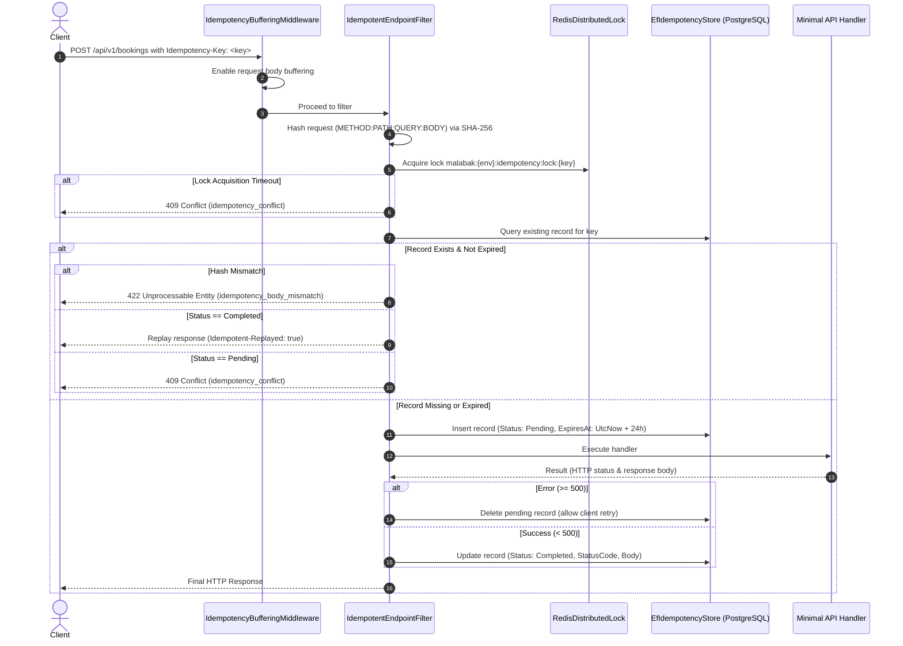

# Reusable Idempotency-Key Architecture Guide

## 1. Overview
The **Idempotency-Key** component provides transparent, thread-safe, and distributed idempotency guarantees for state-mutating HTTP endpoints (e.g., booking creation, payments, wallet debits), complying with **[SECURITY.md §8.4](file:///home/osama/Desktop/mal3abk-backend/SECURITY.md)**.

Clients include an `Idempotency-Key` header with mutation requests. If a request is retried (e.g. due to client timeout or transient network drop), the server guarantees that the action executes exactly once and cached responses are replayed safely without re-executing domain side effects.

---

## 2. Architecture & Request Flow



---

## 3. Core Components

### 3.1 [`IdempotencyRecord`](file:///home/osama/Desktop/mal3abk-backend/src/Malabak.SharedKernel/Persistence/IdempotencyRecord.cs)
Domain entity stored in `idempotency_records` table:
- **`Key`**: Unique client-supplied idempotency key (max 256 characters).
- **`RequestHash`**: Hex-encoded SHA-256 hash of `METHOD:PATH:QUERY:BODY`.
- **`HttpMethod`**, **`RequestPath`**: Endpoint identity for auditing.
- **`StatusCode`**, **`ResponseBody`**, **`ResponseContentType`**: Cached response snapshot.
- **`Status`**: `Pending`, `Completed`, or `Failed`.
- **`CreatedAtUtc`**, **`ExpiresAtUtc`**: 24-hour expiration window.

### 3.2 Request Hasher: [`Sha256RequestHasher`](file:///home/osama/Desktop/mal3abk-backend/src/Malabak.Api/Infrastructure/Idempotency/Sha256RequestHasher.cs)
Reads the buffered request body stream, URL path, query string, and HTTP method to produce a deterministic SHA-256 fingerprint.

### 3.3 Concurrency Control: [`RedisDistributedLock`](file:///home/osama/Desktop/mal3abk-backend/src/Malabak.Api/Infrastructure/Redis/RedisDistributedLock.cs)
Uses Redis distributed lock `malabak:{env}:idempotency:lock:{key}` with configurable lock duration and acquisition timeout (default 30s lock, 5s timeout) to prevent concurrent duplicate execution under network racing.

### 3.4 Cleanup Background Job: [`IdempotencyCleanupJob`](file:///home/osama/Desktop/mal3abk-backend/src/Malabak.Api/Infrastructure/Idempotency/IdempotencyCleanupJob.cs)
A recurring Hangfire job running on the `low` priority queue every 6 hours (configurable via cron) that deletes expired idempotency records (`ExpiresAtUtc <= UtcNow`) in batches.

---

## 4. Usage in Minimal APIs

To require idempotency on an endpoint or route group:

```csharp
app.MapPost("/api/v1/bookings", async (CreateBookingCommand command, ISender sender) =>
{
    var result = await sender.Send(command);
    return result.ToHttpResult();
})
.RequireIdempotency(); // or .RequireIdempotency(required: false)
```

---

## 5. HTTP Response Status Codes

| Status | Condition | Detail / Code |
|---|---|---|
| `400 Bad Request` | Missing `Idempotency-Key` header on required endpoint, or key exceeds 256 chars | `idempotency_key_required` / `invalid_idempotency_key` |
| `409 Conflict` | Concurrent in-flight request with same key holding lock or pending | `idempotency_conflict` |
| `422 Unprocessable Entity` | Same key re-sent with different payload, query, or path | `idempotency_body_mismatch` |
| `2xx / 4xx` | Original response replayed from database store | Header `Idempotent-Replayed: true` |
