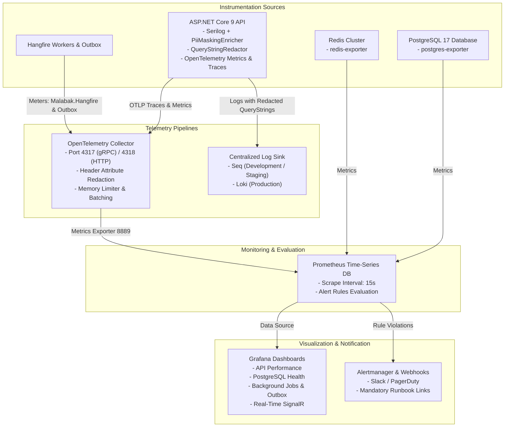

# Observability Stack, Dashboards & Alert Rules Architecture

## 1. Executive Summary

This architecture guide details the implementation of **[TASK-116]** per the observability standards in **[rule.md](file:///home/osama/Desktop/mal3abk-backend/rule.md)** and the security directives of **[SECURITY.md](file:///home/osama/Desktop/mal3abk-backend/docs/SECURITY.md)**.

The Malabak observability stack establishes real-time visibility into the health, latency, security signals, and throughput of all platform components while guaranteeing zero leakage of credentials, tokens, OTPs, or Egyptian personal identifiable information (PII).

---

## 2. Centralized Logs & Query-String Redaction Pipeline

### 2.1 PII Masking & Header Sanitization
- **[`PiiMaskingEnricher`](file:///home/osama/Desktop/mal3abk-backend/src/Malabak.Api/Infrastructure/Logging/PiiMaskingEnricher.cs):** Evaluates all structured log properties. Any key matching passwords, tokens, OTPs, verification codes, API keys, or credit cards is replaced with `***MASKED***`. Egyptian phone numbers (`010...`, `011...`, `012...`, `015...`) are masked preserving only prefix and suffix (e.g., `0101****5678`), and email addresses are obfuscated (`a***@example.com`).
- **OpenTelemetry Header Scrubbing:** The collector drops `Authorization`, `Cookie`, and `X-Api-Key` headers in the `attributes` processor before saving spans.

### 2.2 Query-String Sanitization ([`QueryStringRedactor`](file:///home/osama/Desktop/mal3abk-backend/src/Malabak.Api/Infrastructure/Logging/QueryStringRedactor.cs))
Query strings frequently contain authentication or verification tokens (e.g. email confirmations, password reset redirects, webhooks).
- The `QueryStringRedactor` intercepts HTTP requests during Serilog diagnostic context enrichment.
- Keys such as `token`, `otp`, `verification_code`, `api_key`, `phone`, and `sig` have their values replaced with `***MASKED***`.
- Safe parameters (e.g., `page=1&pageSize=20&sort=name`) remain untouched for diagnostic utility.

---

## 3. Production Grafana Dashboards

Pre-configured dashboard definitions reside in [`infra/observability/dashboards/`](file:///home/osama/Desktop/mal3abk-backend/infra/observability/dashboards/):

| Dashboard | File | Key Visualizations |
|---|---|---|
| **API Performance** | `api-performance.json` | Request throughput (RPS), P95 & P99 latency percentiles, HTTP status code distribution (2xx, 4xx, 5xx), route-level latency heatmap. |
| **PostgreSQL Health** | `database-performance.json` | Active and idle connection count, blocked queries/locks, transaction commit & rollback rates, buffer cache hit ratio (> 99%). |
| **Background Jobs & Outbox** | `background-jobs.json` | Unprocessed outbox backlog count, outbox dispatch duration, Hangfire active worker pool, succeeded/failed job throughput, queue lag. |
| **Real-Time SignalR** | `realtime-and-sockets.json` | Active WebSocket connections, client connect/disconnect rates, hub message broadcast rate, connection lifetime distribution. |

---

## 4. Alerting Rules & Security Signals ([`alert-rules.yml`](file:///home/osama/Desktop/mal3abk-backend/infra/observability/alerts/alert-rules.yml))

Every alert definition specifies severity, trigger condition, evaluation window, and an actionable `runbook_url`:

| Alert Name | Severity | Condition | Incident Runbook Link |
|---|---|---|---|
| `High5xxErrorRate` | **Critical** | HTTP 5xx responses > 1% over 5m | [api-5xx-incident-runbook.md](https://github.com/osamamahmouddev/mal3abk-backend/blob/main/docs/runbooks/api-5xx-incident-runbook.md) |
| `UnauthorizedOrForbiddenSpike` | **Warning** | 401/403 responses > 50/min | [auth-anomaly-incident-runbook.md](https://github.com/osamamahmouddev/mal3abk-backend/blob/main/docs/runbooks/auth-anomaly-incident-runbook.md) |
| `RateLimitTriggerSpike` | **Warning** | HTTP 429 responses > 30/min | [rate-limit-investigation-runbook.md](https://github.com/osamamahmouddev/mal3abk-backend/blob/main/docs/runbooks/rate-limit-investigation-runbook.md) |
| `OtpVolumeSpike` | **Critical** | OTP generation > 100/min | [sms-toll-fraud-runbook.md](https://github.com/osamamahmouddev/mal3abk-backend/blob/main/docs/runbooks/sms-toll-fraud-runbook.md) |
| `RefreshTokenReuseDetected` | **Critical** | Stolen refresh token reuse detected | [token-compromise-runbook.md](https://github.com/osamamahmouddev/mal3abk-backend/blob/main/docs/runbooks/token-compromise-runbook.md) |
| `OutboxBacklogLag` | **High** | Unprocessed outbox events > 500 for > 5m | [outbox-backlog-runbook.md](https://github.com/osamamahmouddev/mal3abk-backend/blob/main/docs/runbooks/outbox-backlog-runbook.md) |
| `HangfireJobFailures` | **High** | Failed background jobs > 5 in 5m | [hangfire-troubleshooting-runbook.md](https://github.com/osamamahmouddev/mal3abk-backend/blob/main/docs/runbooks/hangfire-troubleshooting-runbook.md) |
| `WebSocketConnectionDropSpike` | **High** | SignalR client disconnect rate > 50/min | [signalr-reconnection-runbook.md](https://github.com/osamamahmouddev/mal3abk-backend/blob/main/docs/runbooks/signalr-reconnection-runbook.md) |
| `HighSmsCostRate` | **High** | SMS burn rate exceeds $50/hour | [sms-cost-containment-runbook.md](https://github.com/osamamahmouddev/mal3abk-backend/blob/main/docs/runbooks/sms-cost-containment-runbook.md) |
