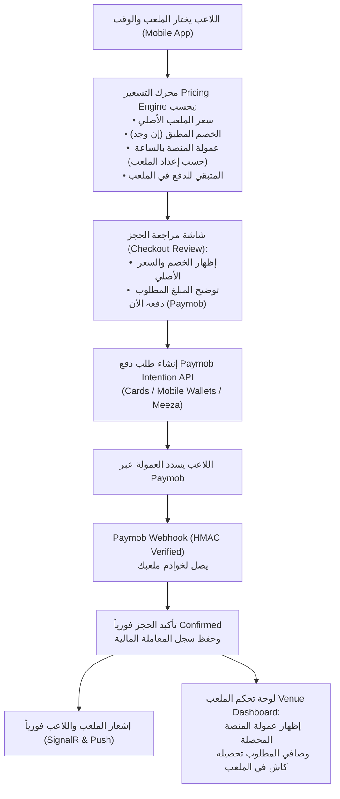

# وثيقة المواصفات الفنية وهندسة النظام: نموذج عمولة المنصة والدفع الإلكتروني عبر Paymob وإظهار الخصومات
# Technical & Architectural Specification: Platform Commission Model, Paymob In-App Checkout & Discount Visibility

---

## 1. الملخص التنفيذي | Executive Summary

تهدف هذه الوثيقة إلى تقديم الحل الهندسي والتنفيذي المتكامل لتطوير نموذج التسعير والتحصيل المالي في منصة **ملعبك (Malabak)**، وفقاً للمتطلبات التالية:
1. **تطبيق عمولة لكل ساعة حجز (Hourly Commission Rate)**: احتساب عمولة ثابتة (أو نسبة مئوية) لصالح المنصة عن كل ساعة يتم حجزها في أي ملعب.
2. **تخصيص العمولة بواسطة الإدارة (Admin Configurable & Per-Club Overrides)**: تحديد قيمة عمولة افتراضية على مستوى المنصة ككل، مع إمكانية تخصيص نسبة/قيمة خاصة بكل نادٍ أو ملعب بشكل منفرد.
3. **الدفع الإلكتروني للعمولة عبر Paymob (In-App Paymob Checkout)**: يدفع اللاعب قيمة عمولة المنصة (أو العربون) مباشرة داخل تطبيق الموبايل عبر Paymob (بطاقات بنكية، محافظ إلكترونية، ميزة)، وتدخل مباشرة في حساب المنصة التجاري.
4. **إبراز الخصومات والعروض في تطبيق الموبايل (Discount Transparency)**: إظهار السعر قبل الخصم، قيمة الخصم، والوفر المالي بشكل جذاب (Strike-through & Badges) لتشجيع الحجوزات.
5. **شفافية العمولة لدى إدارة الملعب (Venue Financial Visibility)**: إظهار عمولة المنصة المحصلة إلكترونياً وصافي المبلغ المتبقي تحصيله نقداً أو بانستاباي في الملعب، مع تضمينها في تقارير الإيرادات (`Venue Reports`).



---

## 2. بنية نموذج العمولات والتسعير | Commission & Pricing Engine Architecture

### 2.1 مستويات تحديد العمولة (Commission Hierarchy)
يتبع احتساب العمولة مبدأ الوراثة والتخصيص:

```
[إعداد المنصة العام Platform Global Default]
             │
             ▼ (يتم استبداله إذا وُجد تخصيص)
[إعداد عمولة الملعب المخصص Per-Venue Custom Override]
```

1. **العمولة الافتراضية للمنصة (Platform Default)**:
   - مسجلة في `platform.platform_settings`:
     - `booking.default_commission_type`: نوع العمولة (`PerHourFixed` أو `Percentage`). القيمة الافتراضية: `PerHourFixed`.
     - `booking.default_commission_rate`: القيمة (مثلاً: `30.00` ج.م لكل ساعة حجز، أو `10%`).
2. **التخصيص لكل نادٍ/ملعب (Per-Venue Override)**:
   - حقول جديدة في جدول الملاعب `venues.venues`:
     - `custom_commission_enabled` (boolean): تفعيل تخصيص لهذا الملعب.
     - `commission_type` (smallint): `0 = PlatformDefault`, `1 = PerHourFixed`, `2 = Percentage`, `3 = ZeroExempt`.
     - `commission_rate` (numeric(10,2)): القيمة الخاصة (مثلاً: ملاعب النادي الأهلي `20.00` ج.م/ساعة، ملاعب الشركاء VIP `15.00` ج.م/ساعة).
   - **صلاحية التعديل**: حصرياً لمدير النظام (`Admin` / `SuperAdmin`) من لوحة تحكم الإدارة. لا يملك صاحب الملعب صلاحية تغيير العمولة.

### 2.2 معادلة احتساب العمولة (Calculation Formula)
نظراً لأن منصة ملعبك تتيح حجز فترات زمنية مختلفة (60 دقيقة، 90 دقيقة، 120 دقيقة، ... بزيادات 15 دقيقة):
- **في حالة العمولة الثابتة بالساعة (PerHourFixed)**:
  $$\text{Commission} = \text{CommissionRate} \times \left( \frac{\text{DurationMinutes}}{60} \right)$$
  *مثال*: إذا كانت العمولة 30 ج.م/ساعة، وحجز اللاعب ساعة ونصف (90 دقيقة):
  $$\text{Commission} = 30 \times 1.5 = 45.00 \text{ EGP}$$
- **في حالة النسبة المئوية (Percentage)**:
  $$\text{Commission} = \text{NetPitchPrice} \times \left( \frac{\text{CommissionPercent}}{100} \right)$$

### 2.3 تحديث بنية الـ DTO والعقود المشتركة (Shared Contracts)

```csharp
namespace Malabak.SharedKernel.Contracts;

public sealed record CommissionBreakdown(
    string Type,                 // "PerHourFixed" | "Percentage"
    decimal Rate,                // 30.00 EGP/hr or 10.00%
    decimal Amount,              // Total calculated commission
    bool IsCustomVenueRate       // true if overridden for this club
);

public sealed record PriceQuoteSnapshot(
    Guid VenueId,
    Guid PitchId,
    DateTime StartUtc,
    DateTime EndUtc,
    int DurationMinutes,
    string Currency,
    decimal OriginalSubtotal,    // السعر الأساسي قبل أي خصم
    decimal Subtotal,            // السعر بعد تطبيق قواعد التسعير (Peak/Weekend)
    decimal Discount,            // قيمة الخصم الموفرة
    string? DiscountRule,        // اسم العرض / الخصم
    decimal PitchTotal,          // صافي إيجار الملعب
    decimal CommissionAmount,    // عمولة المنصة (رسوم الخدمة)
    CommissionBreakdown Commission,
    decimal Total,               // الإجمالي الكلي (إيجار الملعب + عمولة المنصة)
    decimal PayOnlineAmount,     // المبلغ المطلوب دفعه إلكترونياً عبر Paymob
    decimal PayAtVenueAmount,    // المبلغ المتبقي تحصيله في الملعب كاش/انستاباي
    IReadOnlyList<PriceLineSnapshot> Lines,
    DateTime QuotedAtUtc);
```

---

## 3. إظهار الخصومات في الموبايل | Discounts & Offers Presentation

### 3.1 تجربة المستخدم في تطبيق اللاعب (Mobile UX)
يتم دعم نوعين رئيسيين من الخصومات:
1. **خصومات الفترات والمدد (Duration-based Deals)**: مثل "احجز ساعتين واحصل على 100 ج.م خصم".
2. **عروض الأوقات غير الذروة (Off-Peak Deals)**: خصم 20% على الحجوزات الصباحية أو أيام منتصف الأسبوع.

### 3.2 عناصر واجهة الموبايل (Mobile UI Elements)
1. **شاشة اختيار الملاعب والأوقات**:
   - عرض شارة الخصم (Discount Badge): `"وفر ٥٠ ج.م"` أو `"خصم ٢٠٪"`.
   - شطب السعر القديم وإظهار السعر الجديد: ~~٥٠٠ ج.م~~ **٤٥٠ ج.م**.
2. **بطاقة ملخص السعر في شاشة تأكيد الحجز (`BookingReviewScreen`)**:
   - **سعر الملعب الأساسي**: ٥٠٠ ج.م
   - **خصم العرض (عرض الساعتين)**: - ٥٠ ج.م (باللون الأخضر المميز `AppColors.brandGreen`)
   - **رسوم خدمة وحجز ملعبك (عمولة المنصة)**: ٣٠ ج.م
   - **الإجمالي الكلي**: ٤٨٠ ج.م
   - **المطلوب سداده الآن عبر Paymob**: ٣٠ ج.م (عربون / عمولة المنصة لتأكيد وتثبيت الحجز)
   - **المتبقي للدفع في الملعب**: ٤٥٠ ج.م (كاش أو انستاباي عند الحضور)

---

## 4. تكامل بوابة الدفع Paymob | Paymob Integration Architecture

### 4.1 تدفق المعاملة المالية (Transaction Flow)

```
[Mobile App]          [Malabak API]           [Paymob Gateway]           [Venue App]
     │                      │                        │                        │
     │── 1. Create Booking ─>│                        │                        │
     │   (PendingPayment)   │── 2. Create Intention ─>│                        │
     │                      │<─ 3. client_secret ────│                        │
     │<─ 4. Checkout URL ───│                        │                        │
     │                      │                        │                        │
     │── 5. Pay via Paymob (Cards / Mobile Wallet) ──>│                        │
     │                      │                        │                        │
     │                      │<─ 6. Webhook (HMAC) ───│                        │
     │                      │    (Transaction Success)                        │
     │                      │── 7. Verify HMAC &     │                        │
     │                      │      Mark Confirmed    │                        │
     │                      │── 8. Emit SignalR ─────────────────────────────>│
     │<─ 9. SignalR/Push ───│      (Booking Confirmed)                        │
     │   (Booking Pass QR)  │                        │                        │
```

### 4.2 تفاصيل التكامل البرمجي عبر Paymob Intention API
تستخدم المنصة أحدث واجهات Paymob (Intention API v1) الموصى بها:
- **نقطة الاتصال**: `POST https://accept.paymob.com/v1/intention/`
- **الرؤوس (Headers)**: `Authorization: Token <PAYMOB_API_KEY>`
- **جسم الطلب (Request Payload)**:
```json
{
  "amount": 3000,
  "currency": "EGP",
  "payment_methods": [
    "card",
    "wallet"
  ],
  "items": [
    {
      "name": "Malabak Platform Booking Fee",
      "amount": 3000,
      "description": "رسوم حجز وتثبيت ملعب - حجز رقم #MB-26-8941",
      "quantity": 1
    }
  ],
  "billing_data": {
    "first_name": "أحمد",
    "last_name": "محمود",
    "phone_number": "+201012345678",
    "email": "player@malabak.com"
  },
  "customer": {
    "first_name": "أحمد",
    "last_name": "محمود"
  },
  "extras": {
    "booking_id": "019324a1-0000-7000-8000-000000000001",
    "booking_reference": "MB-26-8941",
    "venue_id": "019324a1-...",
    "fee_type": "platform_commission"
  }
}
```

### 4.3 التحقق الأمني من الـ Webhook (HMAC Security & Zero Tampering)
- **الرابط**: `POST /api/v1/payments/paymob/webhook`
- **التوقيع**: حساب HMAC SHA-512 لسلسلة البيانات المتسلسلة المحددة من Paymob ومقارنتها بترويسة التوقيع `hmac`.
- **منع التكرار (Idempotency)**: كل عملية دفع لها `transaction_id` فريد من Paymob يتم تخزينه في `payments.transactions` مع قيد فريد `UNIQUE(gateway_transaction_id)`.
- **التعامل مع انقطاع الاتصال (Resilience)**: إذا أغلق المستخدم التطبيق بعد الدفع مباشرة، يقوم الـ Webhook بتحديث الحجز تلقائياً إلى `Confirmed` وإرسال إشعار فوري (Push Notification) للاعب بتأكيد الحجز وتوليد كود الحجز (Booking QR Pass).

---

## 5. لوحة تحكم الملعب والتقارير المالية | Venue Financial Transparency

### 5.1 في قائمة الحجوزات وتفاصيل الحجز (Bookings List & Modal)
لكل حجز، يظهر تفصيل مالي شفاف وواضح:
- **إجمالي قيمة الحجز**: ٥٠٠ ج.م
- **عمولة منصة ملعبك المحصلة أونلاين**: ٣٠ ج.م (مدفوعة عبر Paymob)
- **المطلوب تحصيله في الملعب (Cash/InstaPay to Collect)**: ٤٧٠ ج.م

### 5.2 في تقارير الإيرادات (`web/apps/venue/src/app/reports`)
تحديث نموذج `RevenueSplit` في الباك إند والواجهة:
- **إجمالي المبيعات (Gross Booked Revenue)**: إجمالي قيمة كافة الساعات المحجوزة.
- **إجمالي عمولات ملعبك (Platform Commissions)**: إجمالي العمولات المستقطعة/المحصلة عبر المنصة.
- **صافي إيراد الملعب (Net Venue Earnings)**: المبالغ التي يتسلمها الملعب فعلياً.
- **تحديث تصدير CSV (Reports Export)**: إضافة أعمدة:
  - `Pitch Rental (EGP)`
  - `Discount (EGP)`
  - `Platform Commission (EGP)`
  - `Payment Method (Paymob/Cash)`
  - `Amount Due at Venue (EGP)`

---

## 6. لوحة تحكم الإدارة وتخصيص الأندية | Admin Dashboard Management

في لوحة تحكم الأدمن (`web/apps/admin`):
1. **صفحة إعدادات المنصة المالية (`/admin/settings/financials`)**:
   - إعداد العمولة الافتراضية لكل ساعة حجز (Default Commission EGP/hour).
   - تفعيل/تعطيل بوابة Paymob للحجوزات (`FeatureFlagKeys.PaymentGateway`).
2. **صفحة تفاصيل الملعب (`/admin/venues/[id]`)**:
   - قسم **"الإعدادات المالية وعمولة المنصة"**:
     - خيار: `استخدام عمولة المنصة الافتراضية (٣٠ ج.م/ساعة)` [مفعل افتراضياً].
     - خيار: `تخصيص عمولة خاصة لهذا الملعب/النادي`.
     - حقل: `نوع العمولة` (مبلغ ثابت لكل ساعة / نسبة مئوية / معفي من العمولة).
     - حقل: `القيمة` (مثلاً: ٢٠ ج.م).
     - حقل: `ملاحظات العقد المالي` (سبب التخصيص، شروط الاتفاق).

---

## 7. مخطط قاعدة البيانات والتعديلات البرمجية | Database Schema Changes

### 7.1 جدول الملاعب (`venues.venues`)
```sql
ALTER TABLE venues.venues
ADD COLUMN custom_commission_enabled BOOLEAN NOT NULL DEFAULT FALSE,
ADD COLUMN commission_type SMALLINT NOT NULL DEFAULT 0, -- 0: PlatformDefault, 1: PerHourFixed, 2: Percentage, 3: Exempt
ADD COLUMN commission_rate NUMERIC(10, 2) NULL;
```

### 7.2 جدول الحجوزات (`booking.bookings`)
```sql
ALTER TABLE booking.bookings
ADD COLUMN platform_commission NUMERIC(10, 2) NOT NULL DEFAULT 0,
ADD COLUMN venue_net_amount NUMERIC(10, 2) NOT NULL DEFAULT 0,
ADD COLUMN online_paid_amount NUMERIC(10, 2) NOT NULL DEFAULT 0,
ADD COLUMN venue_pay_amount NUMERIC(10, 2) NOT NULL DEFAULT 0,
ADD COLUMN is_commission_paid BOOLEAN NOT NULL DEFAULT FALSE,
ADD COLUMN paymob_order_id BIGINT NULL,
ADD COLUMN paymob_transaction_id BIGINT NULL;
```

### 7.3 جدول المعاملات المالية الإلكترونية (`payments.transactions`)
```sql
CREATE TABLE payments.transactions (
    id UUID PRIMARY KEY,
    booking_id UUID NOT NULL REFERENCES booking.bookings(id),
    venue_id UUID NOT NULL,
    player_id UUID NOT NULL,
    gateway VARCHAR(32) NOT NULL DEFAULT 'Paymob',
    gateway_transaction_id VARCHAR(64) NOT NULL,
    gateway_order_id VARCHAR(64) NULL,
    payment_method VARCHAR(32) NOT NULL, -- Card, MobileWallet, Meeza
    amount NUMERIC(10, 2) NOT NULL,
    currency VARCHAR(3) NOT NULL DEFAULT 'EGP',
    status SMALLINT NOT NULL, -- 1: Initiated, 2: Success, 3: Failed, 4: Refunded
    raw_payload_json TEXT NULL,
    created_at_utc TIMESTAMPTZ NOT NULL,
    completed_at_utc TIMESTAMPTZ NULL,
    CONSTRAINT uq_gateway_tx UNIQUE(gateway, gateway_transaction_id)
);
```

---

## 8. خطة التنفيذ خطوة بخطوة | Step-by-Step Implementation Plan

| المرحلة | المهام الرئيسية | المخرجات |
|---|---|---|
| **المرحلة 1: قاعدة البيانات والتسعير (Backend)** | • إضافة حقول العمولة في جدول الملاعب والحجوزات.<br>• تحديث `PricingCalculator` لاحتساب العمولة بالساعة والتفريق بين سعر الملعب وعمولة المنصة.<br>• تحديث `BookingQuoteDto` و `CreateBookingHandler`. | ترحيل EF Core جديد + اختبارات وحدة لاحتساب العمولات والخصومات. |
| **المرحلة 2: تكامل Paymob والـ Webhooks** | • تطوير `PaymobService` للربط مع Intention API.<br>• تطوير الـ Endpoint لاستقبال الـ Webhook مع فحص الـ HMAC.<br>• تحديث حالة الحجز إلى `Confirmed` وإصدار إشعارات فورية عند نجاح الدفع. | مسار دفع إلكتروني متكامل وآمن مع Paymob SandBox و Production. |
| **المرحلة 3: تطبيق الموبايل (Flutter)** | • ربط شاشة مراجعة الحجز لعرض السعر قبل وبعد الخصم بوضوح.<br>• توضيح رسوم المنصة والمطلوب دفعه الآن.<br>• إضافة شاشة Paymob Checkout (WebView / SDK) والدفع بكارت البنك أو المحفظة الذكية.<br>• التوجيه المباشر لتذكرة الحجز (Booking Pass) عند اكتمال الدفع. | تجربة مستخدم سلسة للدفع بدون الحاجة لرفع إيصالات يدوية. |
| **المرحلة 4: لوحة تحكم الملعب (Next.js)** | • إظهار عمولة المنصة في تفاصيل الحجز وجدول الحجوزات.<br>• تحديث تقارير الأرباح `Reports` لتوضيح صافي إيراد الملعب وعمولات المنصة المستقطعة.<br>• تحديث ملف تصدير الإكسيل (CSV). | شفافية مالية تامة لأصحاب الملاعب. |
| **المرحلة 5: لوحة تحكم الإدارة (Next.js)** | • إضافة شاشة لإعداد العمولة الافتراضية في إعدادات المنصة.<br>• إضافة خيار تخصيص عمولة كل ملعب في شاشة تعديل الملعب.<br>• شاشة تقارير أرباح المنصة وعمولات Paymob المجمعة. | تحكم إداري كامل في نسبة وفائدة كل ملعب ونادٍ. |

---

## 9. التوصية الفنية وقرار التصميم | Design Decisions & Recommendations

1. **العمولة كعربون رقمي (Commission as Online Deposit)**:
   - نوصي بشدة بأن تكون عمولة المنصة هي ذاتها "عربون تثبيت الحجز".
   - **الميزة للّاعب**: يدفع مبلغاً بسيطاً لتأكيد الحجز فورياً عبر محفظته (Vodafone Cash / InstaPay / Card) دون الحاجة لانتظار مراجعة إيصال يدوي.
   - **الميزة للملعب**: ضمان جدية اللاعب (منع الـ No-Show) واستلام باقي المبلغ نقداً في الملعب.
   - **الميزة للمنصة**: التحصيل الفوري لأرباح المنصة مباشرة دون الحاجة لمطالبة أصحاب الملاعب بالعمولات لاحقاً أو الدخول في نزاعات تحصيل.
2. **الحفاظ على خيار الدفع اليدوي كبديل (Fallback Mechanism)**:
   - يمكن إبقاء خيار التحويل اليدوي ورفع الإيصال متاحاً للملاعب التي ترغب في ذلك أو في حال رغبة اللاعب في الدفع في الملعب مباشرة وفقاً لسياسة الملعب.
