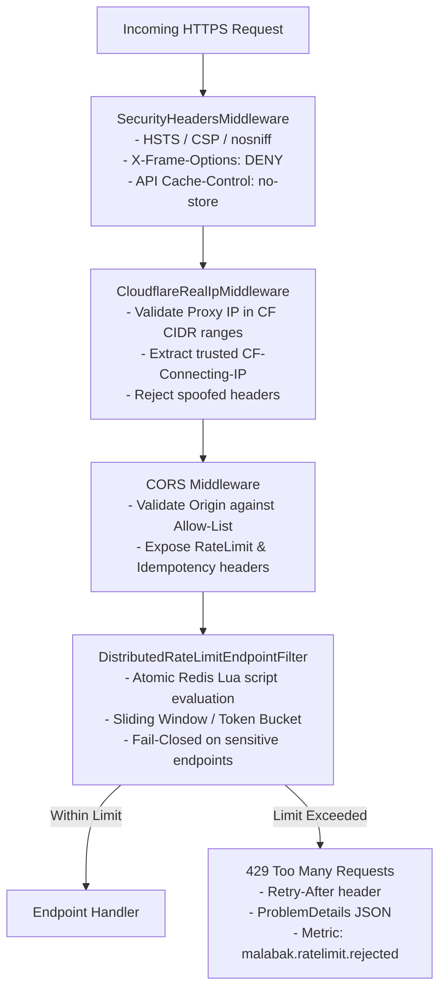

# Security Middleware, Headers, CORS, Cloudflare Real IP & Distributed Rate Limiting

## 1. Overview
This guide documents the security hardening infrastructure implemented in **[TASK-110]**, complying with **[SECURITY.md §6, §7, §15](file:///home/osama/Desktop/mal3abk-backend/SECURITY.md)**, **[rule.md](file:///home/osama/Desktop/mal3abk-backend/rule.md)**, and **[ADR-0004](file:///home/osama/Desktop/mal3abk-backend/docs/adr/0004-hosting-and-data-residency.md)**.

The infrastructure provides five defensive layers:
1. **Security Headers Middleware:** RFC & OWASP-compliant security headers (HSTS, CSP, nosniff, DENY frame options, Referrer-Policy, Permissions-Policy, COOP, and `no-store` API caching).
2. **CORS Allow-List Configuration:** Strict origin allow-list protecting against cross-origin attacks, allowing authorized Web Dashboards (Venue, Admin) and Mobile APIs.
3. **Cloudflare Real Client IP & Origin Verification:** Spoof-proof `CF-Connecting-IP` extraction restricted exclusively to verified Cloudflare IP ranges.
4. **Redis-Backed Distributed Rate Limiter:** Atomic Redis Lua scripts enforcing Sliding Window, Fixed Window, and Token Bucket policies across scaled horizontal instances.
5. **Fail-Closed Protection & 429 Handling:** Sensitive endpoints (OTP, login, password changes) fail-closed if Redis is unavailable; 429 responses return RFC 9457 ProblemDetails with `Retry-After` headers and OpenTelemetry metrics.

---

## 2. Defensive Request Pipeline



---

## 3. Core Components

### 3.1 [`SecurityHeadersMiddleware`](file:///home/osama/Desktop/mal3abk-backend/src/Malabak.Api/Infrastructure/Security/SecurityHeadersMiddleware.cs)
Injects mandatory headers on all responses:
- `Strict-Transport-Security: max-age=31536000; includeSubDomains; preload`
- `Content-Security-Policy: default-src 'self'; frame-ancestors 'none'; object-src 'none'; base-uri 'self'`
- `X-Content-Type-Options: nosniff`
- `X-Frame-Options: DENY`
- `Referrer-Policy: strict-origin-when-cross-origin`
- `Permissions-Policy: geolocation=(self), camera=(), microphone=()`
- `Cross-Origin-Opener-Policy: same-origin`
- For `/api/*`: `Cache-Control: no-store, no-cache, max-age=0, must-revalidate` and `Pragma: no-cache`.

### 3.2 [`CloudflareRealIpMiddleware`](file:///home/osama/Desktop/mal3abk-backend/src/Malabak.Api/Infrastructure/Security/CloudflareRealIpMiddleware.cs)
- Validates the connecting socket `RemoteIpAddress` against official Cloudflare CIDR blocks (`173.245.48.0/20`, `103.21.244.0/22`, `104.16.0.0/13`, `2400:cb00::/32`, etc.).
- When trusted, safely maps `CF-Connecting-IP` to `context.Connection.RemoteIpAddress`.
- If an untrusted direct connection attempts to supply `CF-Connecting-IP`, it logs a security warning and rejects spoofing.

### 3.3 [`RedisDistributedRateLimiter`](file:///home/osama/Desktop/mal3abk-backend/src/Malabak.Api/Infrastructure/Security/RedisDistributedRateLimiter.cs)
Evaluates distributed rate limit policies using atomic Redis Lua scripts:
- **Sliding Window:** Uses Redis Sorted Sets (`ZADD`, `ZREMRANGEBYSCORE`, `ZCARD`) to prevent boundary bursting.
- **Fixed Window:** Uses atomic `INCR` + `EXPIRE`.
- **Token Bucket:** Evaluates fractional token replenishment.
- **Fail-Closed on Sensitive Endpoints:** When `isSensitive = true` (e.g. OTP, Authentication), if Redis fails, requests are rejected with 429/503 to prevent security bypass.

---

## 4. Endpoint Usage

```csharp
app.MapPost("/api/v1/auth/otp/send", SendOtpHolder)
    .RequireDistributedRateLimiting(
        policy: "otp-send",
        permitLimit: 3,
        windowSeconds: 600, // 3 requests per 10 minutes
        isSensitive: true);
```
