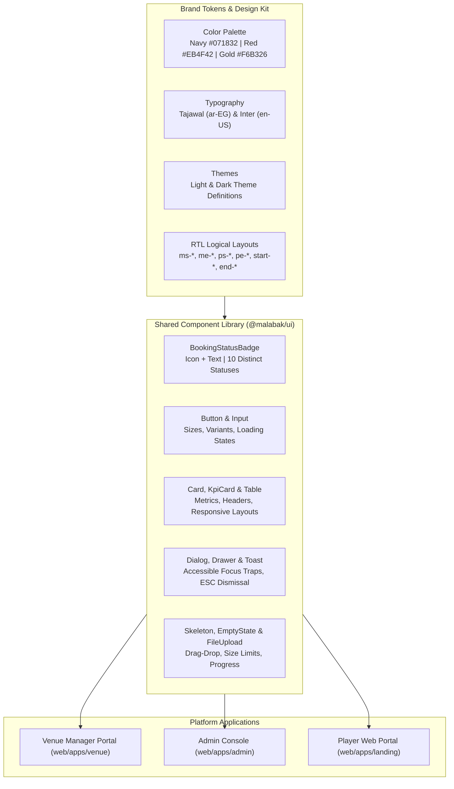

# Web Design System & Brand Tokens Architecture

## 1. Executive Summary

This architecture guide details the implementation of **[TASK-117]** per the front-end engineering rules in **[rule.md](file:///home/osama/Desktop/mal3abk-backend/rule.md)** and the product specifications in **[docs/PRD.md](file:///home/osama/Desktop/mal3abk-backend/docs/PRD.md)**.

The `@malabak/ui` package provides a unified, accessible, and high-performance React component library shared across the **Venue Management Portal**, **Super-Admin Console**, and **Player Web Experience**. The system is built with an **RTL-first** architecture optimized for Egyptian Arabic while offering seamless LTR English support.

---

## 2. Brand Identity & Design Tokens ([`tokens.ts`](file:///home/osama/Desktop/mal3abk-backend/web/packages/ui/src/tokens.ts))

### 2.1 Core Palette
- **Navy (`#071832`):** Primary brand anchor, header bars, executive typography, and primary interactive surfaces in light theme.
- **Red (`#EB4F42`):** Action accent, call-to-actions, destructive operations, and primary highlight in dark mode.
- **Gold (`#F6B326`):** Achievement, pitch ratings, match MVP badges, loyalty rewards, and VIP highlights.

### 2.2 Semantic Colors
- **Success (`#10B981`):** Confirmed bookings, received payments, green availability slots.
- **Warning (`#F59E0B`):** Pending deposits, proof uploaded awaiting review, time-sensitive holds.
- **Error (`#EF4444`):** Rejected bookings, failed bank transfers, validation errors.
- **Info (`#3B82F6`):** Informational banners, scheduled system updates, platform tips.

### 2.3 Typography
- **Arabic (`ar-EG`):** `Tajawal` font family with weights 400 (Regular), 500 (Medium), and 700 (Bold).
- **Latin (`en-US`):** `Inter` font family for international users and numeric tables.

---

## 3. Accessible BookingStatusBadge Component

Per accessibility directives and acceptance criterion `4a342fbc-969c-4d3e-88d0-5526defae1c8`, status is **never conveyed by color alone**:

| Booking Status | Arabic Label | English Label | Icon Semantics |
|---|---|---|---|
| `Draft` | مسودة | Draft | Pencil edit icon |
| `PendingDeposit` | في انتظار العربون | Pending Deposit | Clock waiting icon |
| `ProofSubmitted` | تم رفع الإيصال | Proof Submitted | Clock waiting icon |
| `UnderReview` | قيد المراجعة | Under Review | Clock waiting icon |
| `Confirmed` | مؤكد | Confirmed | Checkmark in circle icon |
| `Rejected` | مرفوض | Rejected | Cross X icon |
| `Expired` | منتهي الصلاحية | Expired | Cross X icon |
| `Cancelled` | ملغي | Cancelled | Cross X icon |
| `Completed` | مكتمل | Completed | Checkmark in circle icon |
| `NoShow` | لم يحضر | No Show | Eye crossed-out icon |

Every badge renders an SVG status icon, explicit localized text, and ARIA attributes (`role="status"`, `aria-label`).

---

## 4. RTL Logical Properties & Internationalization

All components strictly employ CSS logical properties to guarantee flawless mirroring between Arabic (RTL) and English (LTR):
- Padding: `ps-*` (padding-inline-start) and `pe-*` (padding-inline-end) instead of `pl-*` / `pr-*`.
- Margins: `ms-*` (margin-inline-start) and `me-*` (margin-inline-end) instead of `ml-*` / `mr-*`.
- Placement: `start-0` and `end-0` for absolute positioned icons and drawers.
- Text Alignment: `text-start` instead of hardcoded `text-left` or `text-right`.

---

## 5. Storybook & Automated Accessibility (a11y) Testing

- Storybook configuration in `.storybook/main.ts` wires `@storybook/addon-a11y`.
- Automated checks verify:
  1. WCAG 2.1 AA color contrast compliance for text and badge backgrounds.
  2. Keyboard navigability (Tab, Shift+Tab, Enter, Space, Escape) for Dialog, Drawer, and Button.
  3. ARIA attributes and screen reader announcements on interactive controls.
  4. RTL/LTR interactive direction switcher in the Storybook toolbar.
